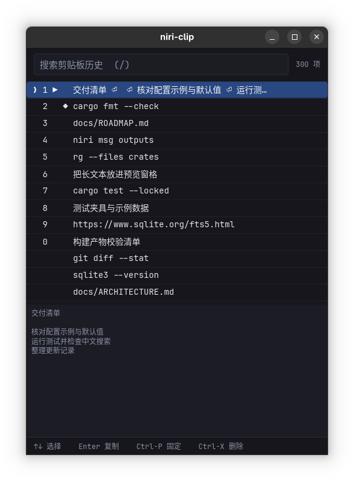

# niri-clip

niri / Wayland 的剪贴板历史管理器。按 `Mod+V` 查找、固定或重新复制文本和图片。历史保存在本地 SQLite 数据库，选择器可用原生窗口、fzf 或 fuzzel。

## 安装

在 niri 会话中使用。安装 Rust 稳定版、C 编译器和 `wl-clipboard`，然后从源码构建。选择器至少安装一种。原生窗口依赖 Wayland 和 libxkbcommon，终端界面需要 fzf 0.71 以上和终端模拟器，fuzzel 可独立使用。

```sh
git clone https://github.com/lishengshang/niri-clip
cd niri-clip
cargo install --locked --path crates/niri-clip
cargo install --locked --path crates/niri-clip-gui   # 可选，原生窗口
```

确保 `~/.cargo/bin` 在 niri 的 `PATH` 中。当前分发方式为源码安装。AUR、crates.io 和预编译发布包的进度见[路线图](docs/ROADMAP.md)。

## 开始使用

1. 选择一种方式启动捕获。使用 Cargo 默认安装位置时，可安装 systemd 用户服务。

   ```sh
   niri-clip install-service
   systemctl --user daemon-reload
   systemctl --user enable --now niri-clip.service
   ```

   也可以在 niri 配置顶层添加 `spawn-at-startup "niri-clip" "daemon"`，在下次登录时自动启动。要在当前会话立即启动，可运行 `niri msg action spawn -- niri-clip daemon`。

2. 在 niri 配置的 `binds` 中添加快捷键。仓库也提供[快捷键和浮动窗口规则](assets/niri-clip.kdl)。

   ```kdl
   binds {
       Mod+V { spawn "niri-clip" "tui"; }
   }
   ```

3. 复制一段文字，按 `Mod+V` 打开历史，用方向键选择，按 `Enter` 复制，再回到目标应用粘贴。遇到空列表或快捷键无响应时，运行 `niri-clip doctor` 检查守护进程、绑定和依赖。

在 niri 中，把原生浮窗拖到顺手的位置后关闭。下次在同一显示器上打开时会恢复该位置，首次打开或换显示器时使用 niri 的窗口规则。设置 `remember_window_position = false` 可始终使用规则指定的位置。

默认关闭浮窗后 GUI 进程立即退出。如果经常连续打开历史，可在 `~/.config/niri-clip/config.toml` 中设置 `gui_idle_timeout_secs = 30`。关闭时会销毁窗口，进程在接下来的 30 秒内保留字体等资源。期间再按 `Mod+V` 会从最新历史打开一个新窗口。超时后进程自动退出，设回 `0` 可恢复默认行为。

## 搜索与预览



默认优先选择原生窗口。fzf 需要 0.71 或更新版本，在快捷键启动时由终端承载。fzf 版本过低或缺少终端时会回退到已安装的 fuzzel。显式配置 `tui_backend = "fuzzel"` 可直接打开 fuzzel。原生窗口支持中文输入法。fzf 在菜单载入的条目中筛选，原生窗口和 `niri-clip search` 可查询全库。

| 原生窗口 | 操作 |
|---|---|
| `/` 或 `Ctrl+F` | 搜索历史 |
| `Tab` / `Shift+Tab` | 在搜索框和结果间切换，保留查询 |
| `↑` / `↓` | 移动选中项并预览 |
| `Page Up` / `Page Down`（结果区） | 按页移动选中项 |
| `Home` / `End`（结果区） | 选择首项或末项 |
| `Shift+Page Up` / `Shift+Page Down` | 滚动文本预览 |
| `Enter` / 左键 | 复制并关闭 |
| `Ctrl+Y` / 右键 | 复制并保留窗口 |
| `Ctrl+P` | 固定或取消固定 |
| `Ctrl+X` | 在结果区删除，在搜索框剪切文字。删除固定条目需松开后再按一次 |
| `1`–`9`、`0` | 浏览时快选前十项，搜索时使用 `Alt` 加数字 |
| `Esc` | 退出搜索、取消删除确认或关闭窗口 |

`▶` 标记普通剪贴板最近成功捕获或从历史复制的条目。普通剪贴板为空或其内容被跳过时清除标记，`delete-current` 随后无操作。PRIMARY 划选仍可入库。原生窗口用 `◆` 标记固定条目。
取消固定会刷新条目的最近活动时间，把它移到普通历史开头。按日期清理也按最近活动时间计算。

## 配置与数据

配置位于 `${XDG_CONFIG_HOME:-~/.config}/niri-clip/config.toml`，首次运行可直接使用默认值。要捕获并预览 PNG、JPEG、WebP，在配置文件中加入以下内容。终端内渲染图片需要 `chafa`。

```toml
enable_image_preview = true
```

默认保留上限为 750 条，固定条目受保护。文本单条上限为 1 MiB，图片单张上限为 10 MiB。daemon 启动时按图片总配额清理，固定条目和当前项受保护。可调整历史容量、预览、PRIMARY 选区、通知和敏感内容过滤规则。[配置项与默认值](config/config.toml.example)

数据库和图片位于 `${XDG_STATE_HOME:-~/.local/state}/niri-clip/`，以明文保存。`ignore_regex` 在捕获时过滤匹配的文本。规则无效时暂停文本捕获，修正配置后在下一次捕获恢复。标为敏感的 Wayland 剪贴板事件会被跳过。无显著格式或标记的密码可能进入历史。修改规则后，可先用 `wipe --sensitive --dry-run` 查看历史中受影响的条数。

| 用途 | 命令 |
|---|---|
| 查看状态、磁盘占用 | `niri-clip status`、`niri-clip stats` |
| 搜索全库 | `niri-clip search '关键词'` |
| 导出与恢复 | `niri-clip export history.ndjson`、`niri-clip import history.ndjson` |
| 从 cliphist 迁移 | `niri-clip migrate` |
| 查看命令和参数 | `niri-clip --help`、`niri-clip <命令> --help` |
| 阅读命令手册 | `niri-clip man \| man -l -` |

导出需要新文件路径，以保留已有数据库和备份。导入前可运行 `niri-clip import history.ndjson --dry-run` 检查内容和预计新增条数，预检不会创建或迁移数据库。

## 开发

```sh
cargo fmt --check
cargo clippy --all-targets --locked -- -D warnings
cargo test --locked
cargo bench --locked -p niri-clip-core --bench store
```

构建与查询基准、进程开销和大库测试命令见[架构与性能](docs/ARCHITECTURE.md)。版本变化见[更新记录](docs/CHANGELOG.md)。本项目采用 [MIT 许可证](LICENSE)。
